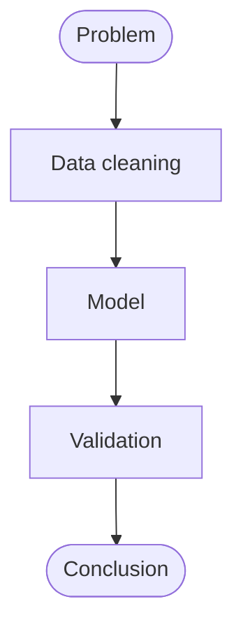
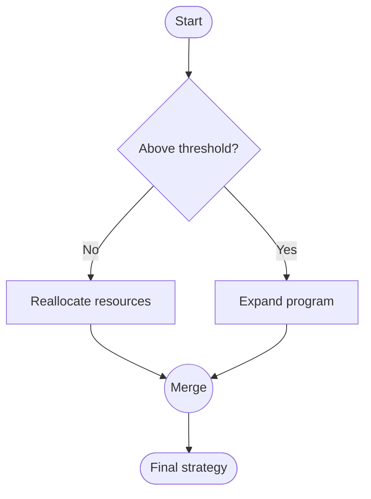
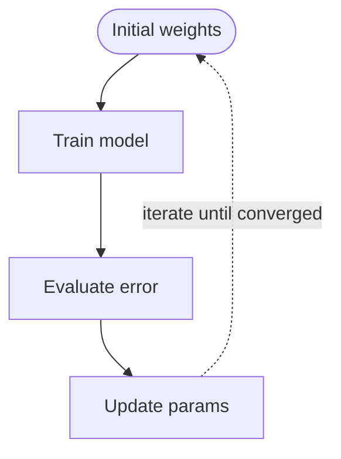
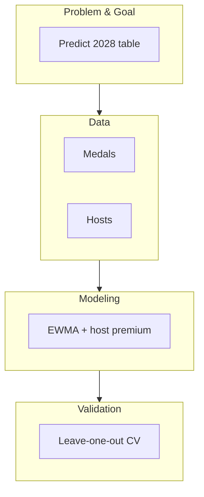
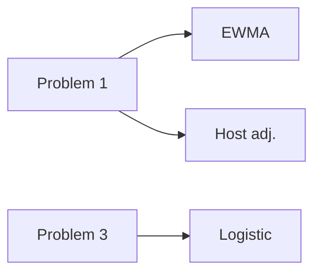

# 论文框架图 / 流程图制作指南（14 种模板）

美赛论文的 Introduction 几乎必须配一张**研究框架图/流程图**，Model 章节也常需要一个**算法流程图**。它能让评委在 10 秒内看懂整体思路，是获奖论文的标配。

本指南配套 `scripts/flowchart.py`：**纯 matplotlib 代码作图**，不需要 draw.io / Graphviz / TikZ，输出矢量 PDF + 300dpi PNG，与全文其他图风格统一。

---

## 0. 为什么用代码画，而不是拖拽？

| 拖拽工具（draw.io/PPT）的问题 | 代码作图（本 skill）的优势 |
|---|---|
| 改一个字要重新对齐，容易拖歪 | 内容全是字符串参数，改完重跑即可 |
| 箭头容易指错框、穿过文字 | 箭头从**框边界锚点**出发，坐标由布局函数算出，不可能指错 |
| 框大小/间距不一致 | 同一函数内统一 `bw/bh/gap`，天然对齐 |
| 无法版本管理、无法批量重做 | `.py` 可 diff、可复用、可换数据重绘 |
| 导出常被栅格化 | 直接导出 PDF 矢量，LaTeX 插图不糊 |

> 若你确实想在可视化编辑器里微调，本文件末尾给每种图型附了 **Mermaid 源码**（文本可编辑，draw.io / Typora / VS Code 均可渲染）。

---

## 1. 什么时候必须上图

| 位置 | 图类型 | 对应函数 |
|---|---|---|
| Introduction | 研究框架图 / 技术路线图 | `framework_bands`、`framework_three_column` |
| Introduction / §2 | 问题分解、阶段时间轴 | `decomposition_tree`、`timeline_phases` |
| Model section | 模型结构图 / 算法流程 | `flow_vertical`、`layered_architecture`、`flow_iterative` |
| Model section | 判断/分支逻辑 | `flow_decision` |
| 数据章节 | 数据流水线 | `ipo_pipeline`、`flow_horizontal` |
| 多任务论文 | 任务流水线、方法映射 | `flow_snake`、`method_mapping`、`problem_model_output` |
| Memo/非技术报告 | 简化版框架图 | `swimlane` |

**原则**：图必须提供文字之外的**额外信息**（结构、依赖、分支、阶段），而不是把文字列表图形化。没有这张图读者仍能理解全文 → 说明这图不必要。

---

## 2. 快速开始

```python
import sys
sys.path.insert(0, str(Path(__file__).resolve().parent))
from flowchart import apply_fc_style, save_figure, framework_bands

apply_fc_style()
fig = framework_bands([
    ("Problem\n& Goal", ["Predict 2028 medals", "Explain host effect"]),
    ("Data",          ["Medal counts", "Athletes", "Hosts", "Programs"]),
    ("Modeling",      ["Recency-weighted average", "Host premium",
                       "Bootstrap interval"]),
    ("Validation",    ["Leave-one-Games-out CV", "Calibration"]),
    ("Conclusion",    ["Ranking & policy", "Coach advice"]),
], title="Research framework")
save_figure(fig, "fig_framework")      # -> fig_framework.pdf + fig_framework.png
```

**内容调整 = 只改列表里的字符串**。所有函数都接受标题、框类型、颜色、字号、间距等参数。

---

## 3. 14 种图型总表

| # | 函数 | 用途 | 关键参数 |
|---|---|---|---|
| 1 | `flow_vertical` | 纵向线性步骤（方法流程、求解步骤） | `labels, kinds, bw, bh, gap` |
| 2 | `flow_horizontal` | 横向线性流水线（数据→模型→结论） | `labels, kinds, bh` |
| 3 | `flow_snake` | 超长链条折行（>6 步） | `labels, ncol` |
| 4 | `flow_decision` | 菱形判断 + Yes/No 分支 + 汇合 | `start, question, branches, end` |
| 5 | `flow_iterative` | 带反馈回路的迭代/收敛流程 | `labels, loop_label` |
| 6 | `framework_bands` | **五带技术路线图（MCM 默认框架图）** | `bands, band_h, label_w` |
| 7 | `framework_three_column` | Phase \| Content \| Methods 三栏框架 | `rows, headers` |
| 8 | `swimlane` | 泳道图（阶段/角色横向分区） | `lanes, lane_h` |
| 9 | `layered_architecture` | 分层架构（数据层→模型层→决策层） | `layers` |
| 10 | `method_mapping` | Phase × Method 方法映射矩阵 | `phases, methods, mapping` |
| 11 | `decomposition_tree` | 问题分解树（root→分支→子项） | `root, branches` |
| 12 | `ipo_pipeline` | Input → Process → Output | `inputs, processes, outputs` |
| 13 | `timeline_phases` | 阶段时间轴（上下交替） | `phases` |
| 14 | `problem_model_output` | 问题→模型→产出 三列映射 | `problems, models, outputs` |

### 各图型细节

**1. `flow_vertical` / **2.** `flow_horizontal`**
首尾自动用 `terminal`（绿色胶囊），中间为 `process`。`kinds` 可覆盖，例如
`kinds=["terminal","process","decision","process","terminal"]`。

**3. `flow_snake`**：`ncol` 控制每行几个；行内左右交替，行末自动用 Z 形折线接到下一行首框。
适合"10 个求解步骤"这类长链，避免图被拉得又细又长。

**4. `flow_decision`**：
```python
flow_decision(
    "Estimated medals", "Above threshold?",
    [("Reallocate resources", ["Revise training", "Seek funding"]),
     ("Expand program",       ["Add coaching staff"])],
    "Final strategy")
```
`branches` 每支 = `(分支结果, [该分支下的步骤…])`；`yes_no=True` 会在连线上标 Yes/No。
分支框宽度按画布自动收缩并留边，**绝不会越界裁切**；分支下方用"汇合总线"收束，无交叉线。

**5. `flow_iterative`**：最后一个框用红色虚线回路指回第一个框，`loop_label` 自定义回路文字（如 `"until |Δ|<1e-6"`）。

**6. `framework_bands`**：最常用的 MCM 框架图。左侧实色阶段标签 + 右侧内容块，条带间向下箭头。
`bands = [(阶段名, [内容块…])…]`，一般 4–6 条。内容块数量可不同。

**7. `framework_three_column`**：`rows = [(阶段, 研究内容, 方法)…]`；行内左→右箭头，阶段列纵向串联。

**8. `swimlane`**：`lanes = [(泳道名, [步骤…])…]`，例如按 Data / Model / Validate / Report 分区。

**9. `layered_architecture`**：`layers = [(层名, 说明)…]` **自上而下**排列，层间双箭头表示接口。

**10. `method_mapping`**：`mapping` 是与 `phases` 等长的 0/1 矩阵，`True` 的格子填色并打点。用于"哪个问题用了哪些方法"。

**11. `decomposition_tree`**：`branches` 支持 `"分支"` 或 `("分支", ["子项"…])` 两种写法；子项纵向串联。

**12. `ipo_pipeline`**：三列各自纵向堆叠，列间取中间行连箭头。

**13. `timeline_phases`**：`phases` 支持 `"阶段"` 或 `("阶段","说明")`；上下交替避免拥挤。

**14. `problem_model_output`**：与任务拆解一一对应，非常适合"问题一~四 → 各自模型 → 各自产出"。

---

## 4. 排版规范（Nature / 美赛通用）

- **配色**：同一阶段同一色系；阶段色取自 `BAND_COLORS`（NPG 同源）。关键模块用强调色。
- **文字**：框内 **≤ 6 个英文单词**，最多 2 行；字号 7.5–9pt，保证打印可读。
- **框**：同类框等宽等高；`box()` 已按框宽自动折行，不会溢出。
- **箭头**：只用 4 种语义 —— 顺序（右/下）、汇合、分支、反馈（虚线）。**每个箭头的含义必须唯一且清楚。**
- **对齐**：同一函数的 `gap` 统一，天然等距。跨函数拼接时手动对齐 x/y。
- **留白**：不要塞满；标题不进 caption（图上标题可省略，caption 里写 `Figure 1 | …`）。

---

## 5. 输出格式

- 默认同时输出 **PDF（矢量）+ PNG（300dpi）**，由 `save_figure(fig, name, outdir)` 完成。
- LaTeX 中插入 PDF：`\includegraphics{fig_framework.pdf}`，**不要栅格化**。
- 若期刊/模板要求，可另存 SVG：`fig.savefig("x.svg")`（`apply_fc_style()` 已设 `svg.fonttype="none"`，文字保持可编辑）。

---

## 6. 正确性自检清单（"图不能有错"）

**画之前**
- [ ] 这张图提供了文字之外的额外信息吗？
- [ ] 图型选对了吗（顺序→flow_*，分层→layered，决策→decision）？

**画之后逐项核对**
- [ ] 每个箭头都**起于框边缘、止于框边缘**吗（没有指进框里 / 指到空白）？
- [ ] 有没有框被画布**裁掉**？（长标签、多分支时最容易发生）
- [ ] 文字有没有溢出框、被压线、或小到需要放大才能读？
- [ ] 有没有**交叉线**？分支/汇合是否用了独立通道？
- [ ] 所有阶段/步骤都覆盖了吗？有没有漏掉子任务？
- [ ] 配色是否与全文其他图一致？同一含义是否同一颜色？
- [ ] 图题是否写进了 caption（而不是塞在图上）？

> `flowchart.py` 的 `_demo()` 生成 14 张示例图，可用作回归检查基线：
> `python flowchart.py fc_demo`

---

## 7. 反面案例

- ❌ 箭头指向不明，或两个框之间有多条无意义交叉线
- ❌ 文字过多导致框被撑变形 / 文字溢出框外
- ❌ 配色杂乱，像 PPT 模板；同一含义用不同颜色
- ❌ 流程图 = 文字列表的图形化翻译，没有额外信息量
- ❌ 框大小不一、间距忽宽忽窄、箭头长短悬殊
- ❌ 为了好看加装饰阴影/渐变/3D（Nature 风格一律不要）

---

## 8. Mermaid 源码（想手动微调时用）

若需要在可视化编辑器里改，可用下面的等价 Mermaid 源码（Typora / VS Code / draw.io「粘贴 Mermaid」均可渲染）。

**纵向流程**


**判断分支**


**迭代回路**


**五带路线图**


**方法映射**


首行方向的 `TD` 可改 `LR`（横向）、`RL`/`BT`（反向）；节点括号：`[]` 矩形、`()` 圆角、`([])` 胶囊、`{}` 菱形、`(())` 圆形。

---

## 9. 与 `figure-cookbook.md` 的协作

- **流程图/框架图** → 本文件 + `scripts/flowchart.py`
- **数据图/统计图**（柱状、热图、ROC、扇形预测…49 种）→ `figure-cookbook.md` + `scripts/nature_plot.py`
- 两者共用同一 NPG 配色与导出规范，拼在一篇论文里风格一致。
